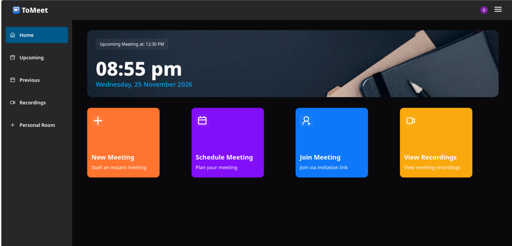
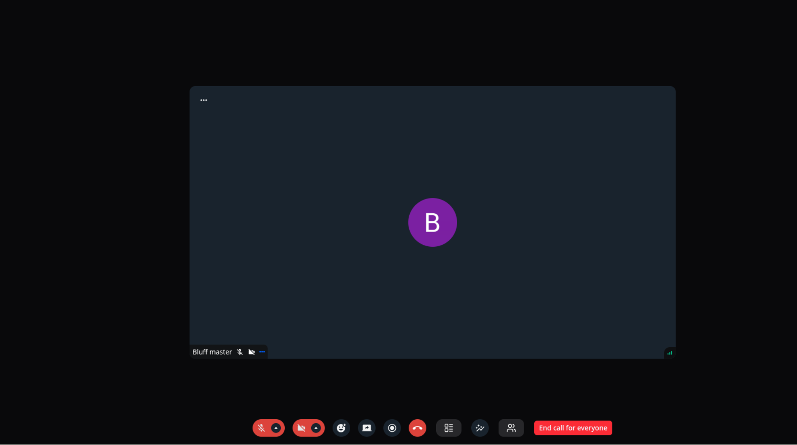
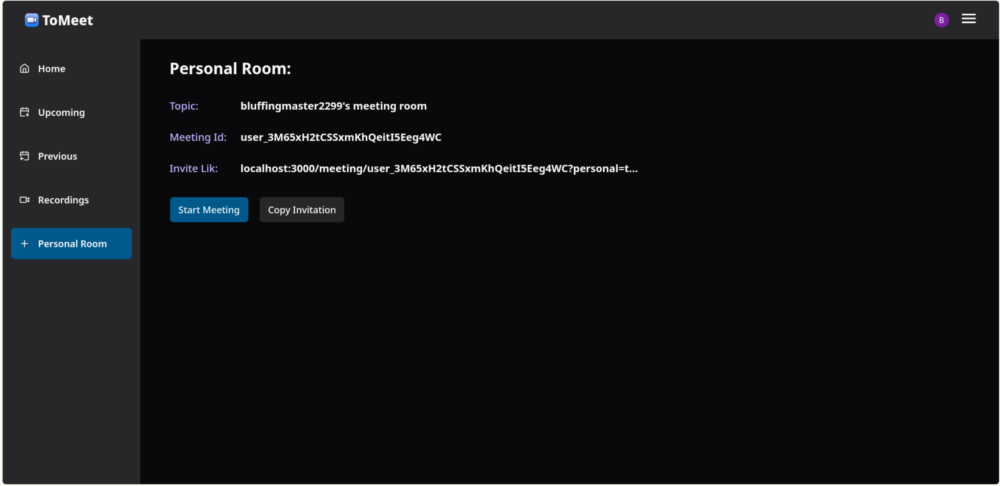
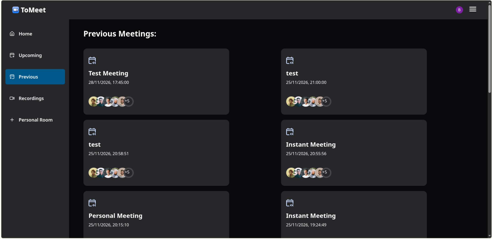

# 🎥 ToMeet

A full-stack video conferencing app inspired by Zoom. Start instant meetings, schedule calls for later, join with a link, and watch recordings of past meetings, all with secure authentication and real-time video.

**Live demo:** [to-meet-gamma.vercel.app](https://to-meet-gamma.vercel.app/)

## ✨ Features

- 🔐 **Authentication** with Clerk (sign up, sign in, protected routes)
- ⚡ **Instant meetings** with one click
- 📅 **Schedule meetings** with a date, time, and description
- 🔗 **Join via link** or meeting ID
- 📋 **Copy and share invitation links**
- 🕘 **Previous meetings** list
- 🔜 **Upcoming meetings** list
- 📼 **Recordings** list with playback
- 🎙️ In-call controls: mute/unmute, camera on/off, screen sharing, participant list, layout switching
- 📱 Responsive UI built with Tailwind CSS

## 🛠️ Tech Stack

| Area           | Technology                                      |
| -------------- | ----------------------------------------------- |
| Framework      | [Next.js](https://nextjs.org/) (App Router)     |
| Language       | TypeScript                                      |
| Styling        | [Tailwind CSS](https://tailwindcss.com/)        |
| Authentication | [Clerk](https://clerk.com/)                     |
| Video / Audio  | [Stream Video SDK](https://getstream.io/video/) |
| Deployment     | Vercel                                          |

## 📸 Screenshots

<!-- Add screenshots to a /public/screenshots folder and update the paths -->

| Home                                                     | Meeting Room                                                    |
| -------------------------------------------------------- | --------------------------------------------------------------- |
|                    |                     |
| Personal Room                                            | Previous Meetings                                               |
|  |  |

## 🚀 Getting Started

### Prerequisites

- Node.js 18 or later
- A [Clerk](https://clerk.com/) account
- A [Stream](https://getstream.io/) account (Video & Audio)

### 1. Clone the repository

```bash
git clone https://github.com/rahul-t0mar/to-meet
cd main
```

### 2. Install dependencies

```bash
npm install
```

### 3. Set up environment variables

Create a `.env.local` file in the project root:

```env
# Clerk
NEXT_PUBLIC_CLERK_PUBLISHABLE_KEY=
CLERK_SECRET_KEY=
NEXT_PUBLIC_CLERK_SIGN_IN_URL=/sign-in
NEXT_PUBLIC_CLERK_SIGN_UP_URL=/sign-up

# Stream
NEXT_PUBLIC_STREAM_API_KEY=
STREAM_SECRET_KEY=

# App
NEXT_PUBLIC_BASE_URL=http://localhost:3000
```

| Variable                                                | Where to get it                                                  |
| ------------------------------------------------------- | ---------------------------------------------------------------- |
| `NEXT_PUBLIC_CLERK_PUBLISHABLE_KEY`, `CLERK_SECRET_KEY` | Clerk Dashboard → API Keys                                       |
| `NEXT_PUBLIC_STREAM_API_KEY`, `STREAM_SECRET_KEY`       | Stream Dashboard → your app → API Keys                           |
| `NEXT_PUBLIC_BASE_URL`                                  | `http://localhost:3000` locally, your deployed URL in production |

### 4. Configure Stream permissions (for recordings)

In the Stream Dashboard, go to **Video & Audio → Call Types → default → Permissions** and make sure the roles your users have (for example `user` and `call-member`) can **start recording** and **list recordings**. Recording must also be enabled in the call type settings.

### 5. Run the development server

```bash
npm run dev
```

Open [http://localhost:3000](http://localhost:3000) in your browser.

## 📁 Project Structure

```
├── app/
│   ├── (auth)/              # Sign in / sign up pages
│   ├── (root)/              # Home, upcoming, previous, recordings, meeting pages
│   └── layout.tsx
├── components/
│   ├── common/              # CallList, MeetingCard, Loader, etc.
│   └── ...                  # Meeting room, setup, modal components
│   └── ui                   # Shadcn-ui components
├── hooks/
│   └── useGetCalls.ts       # Fetches the user's calls from Stream
│   └── useGetCallsById.ts   # Fetches the user's calls with a particular id from Stream
├── providers/
│   └── StreamClientProvider.tsx
├── actions/                 # Server actions (Stream token generation)
├── constants/
├── public/
└── ...
```

Adjust this to match your actual folder layout.

## 🔄 How It Works

1. **Clerk** handles sign-in and gives each user an identity.
2. A **server action** generates a Stream user token for the signed-in Clerk user.
3. `StreamVideoProvider` creates the Stream client with that token.
4. Creating a meeting calls `client.call("default", id).getOrCreate(...)` with optional start time and description.
5. `useGetCalls` queries the user's calls to populate the Previous, Upcoming, and Recordings tabs.
6. The meeting room uses Stream's prebuilt UI components for video, audio, and controls.

## 📜 Scripts

| Command         | Description               |
| --------------- | ------------------------- |
| `npm run dev`   | Start the dev server      |
| `npm run build` | Create a production build |
| `npm run start` | Run the production build  |
| `npm run lint`  | Lint the codebase         |

## ☁️ Deployment

The easiest way to deploy is [Vercel](https://vercel.com/):

1. Push the repo to GitHub.
2. Import the project on Vercel.
3. Add all environment variables from `.env.local` (set `NEXT_PUBLIC_BASE_URL` to your production URL).
4. Deploy.

## 🧩 Troubleshooting

- **429 Too Many Requests from Stream:** you're hitting the API rate limit. Avoid running `queryCalls` or `queryRecordings` from many components at once, and cap how many calls you query.
- **403 when fetching recordings:** the user's role lacks the "list recordings" permission in the Stream call type settings.
- **Invalid token errors:** check that `STREAM_SECRET_KEY` and `NEXT_PUBLIC_STREAM_API_KEY` belong to the same Stream app.

## 🗺️ Roadmap

- [ ] In-meeting chat
- [ ] Waiting room
- [ ] Meeting passcodes
- [ ] Calendar integration

## 🤝 Contributing

Contributions are welcome.

1. Fork the repo
2. Create a branch: `git checkout -b feature/your-feature`
3. Commit your changes: `git commit -m "Add your feature"`
4. Push: `git push origin feature/your-feature`
5. Open a pull request

## 📄 License

This project is licensed under the MIT License. See the [LICENSE](./LICENSE) file for details.

## 🙏 Acknowledgements

- [Stream](https://getstream.io/) for the video SDK
- [Clerk](https://clerk.com/) for authentication
- [Next.js](https://nextjs.org/) and [Tailwind CSS](https://tailwindcss.com/)

---

Built by [Rahul Tomar](https://github.com/rahul-t0mar)
